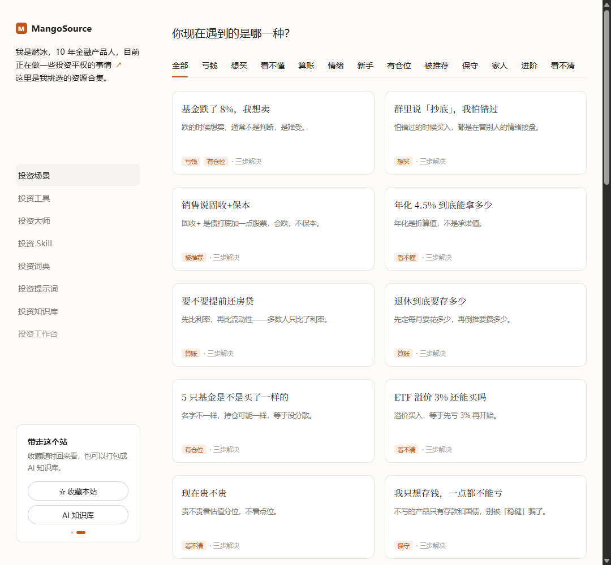
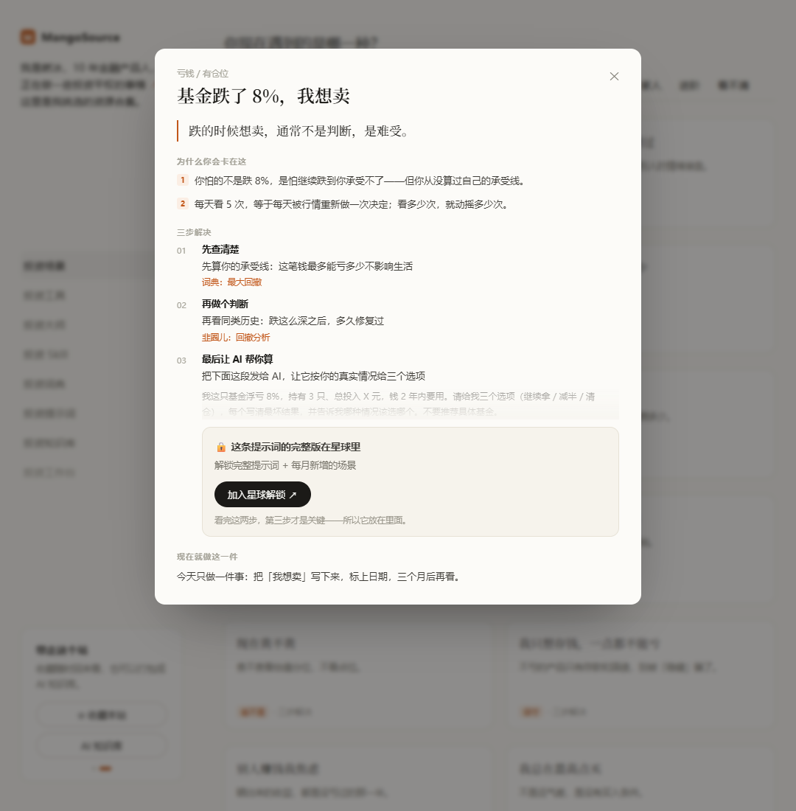
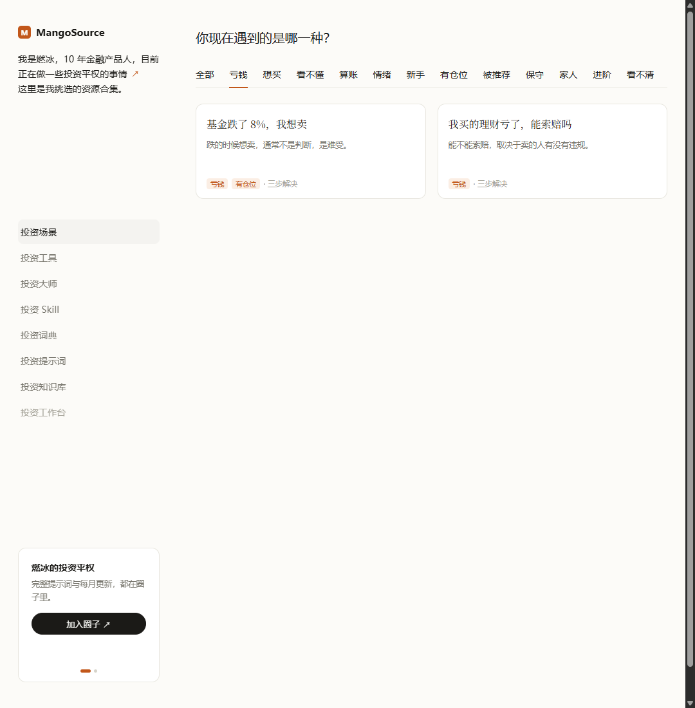
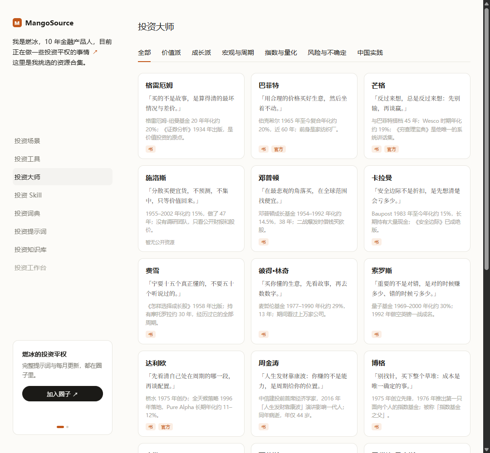
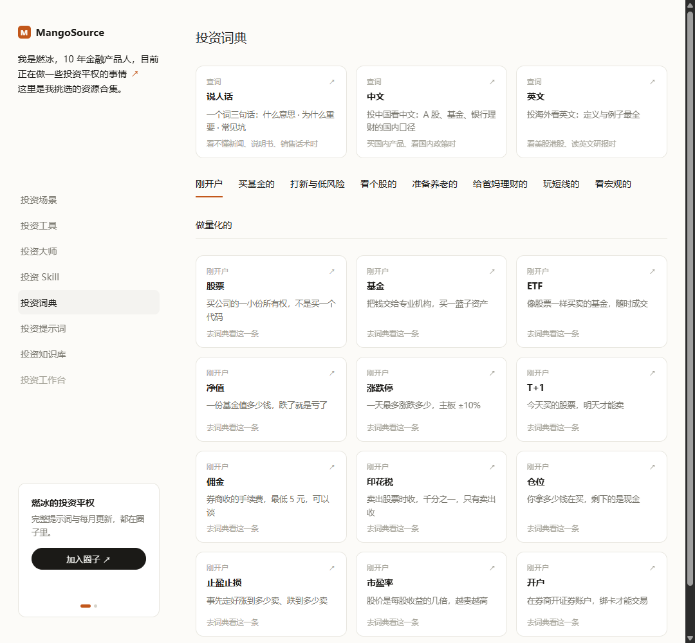

# 用 WorkBuddy 搭了个自己的投资资源工作台

我发现投资相关的资料越来越割裂。看行情用券商软件，查公司用 AI，图表在另一个平台。研究越做越深，电脑里只攒下一堆零散的 Markdown 文件。

每天准备研究，眼前还是一堆工具名。自己为什么收集这个、上次用它解决了什么，要翻回笔记才想得起来。

所以我想把这些入口彻底打通：点开一个场景，顺手就能看到该用什么工具、该问 AI 什么。

后来我用 WorkBuddy 搭了个站，叫 MangoSource。它按「你遇到什么」组织，我把 21 个真实场景、44 个工具、21 位大师、9 类词典和 6 条提示词全接了进来，按我自己的使用习惯排了版。

整个站主要分六块：投资场景、投资工具、投资大师、投资 Skill、投资词典、投资提示词。

在「投资场景」这一页，每一条都是你真的会说出口的话。点开「基金跌了 8%，我想卖」，它给你三步解法，外加一段能直接复制给 AI 的提示词。

这些关注点现在有了日常查看的位置：选中一个场景，可以看它为什么卡住、分三步怎么走、今天先做哪一件事。碰到新消息，马上就能对照当时的判断依据，不用再去翻箱倒柜找笔记。

日常查工具、看词条，打开固定页面就够了。但我还想要一步：从你此刻的处境出发，直接把最该看的那层摆到面前。

普通的资料站搭好后，每天只是机械地列一堆链接，至于今天该看什么、几组资料之间什么关系，还得自己去扒。

这里的场景入口是按处境组织的：先看你「亏钱 / 想买 / 看不懂 / 算账」，再围绕这个处境把工具、词典、提示词摆齐。

比如你输入「基金跌了 8%」，首页直接把承受线、同类回撤、下一个动作三件事摆在一起，不用在十几个页面里来回横跳、自己拼凑信息。

想看方法，就看投资大师和价值 / 成长 / 周期 / 量化 / 中国实践五派；想搞懂一个词，就按「你是谁」进对应的身份词典。

我之前试过自己从零写个资料站，但很快发现，前端只是皮毛，最要命的是背后的苦力活：资料从哪找？怎么核？不同来源的口径怎么对齐？多久更新一次？所以用 WorkBuddy 搭的时候，我把力气都花在这些地方。

我觉得这才是重点——数据和工具我核好，你只管把问题问对。

不荐股，不预测，不承诺收益。它只做一件事：帮你把问题问对，把最坏情况算清。

搭好的应用在下面，扫开就能用。你要是觉得有用，转给那个总在群里问「现在能不能买」的朋友。

