# 用 WorkBuddy 搭了个自己的投资资源工作台

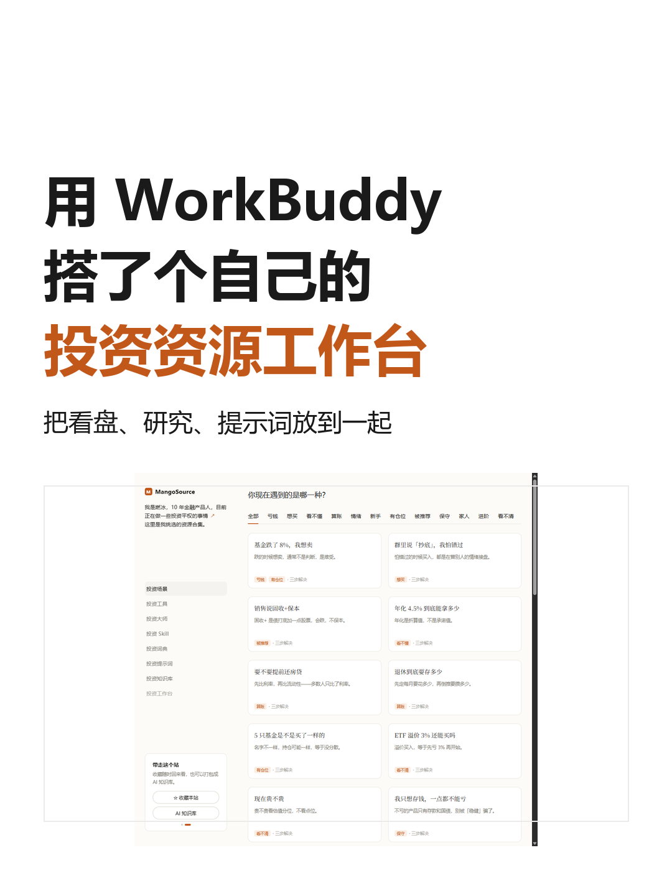

现在跟投资相关的资料搞得很割裂：用券商软件看行情，用 AI 查公司，图表在另一个平台。研究越做越深，电脑里却只攒下一堆零散的 Markdown 文件。

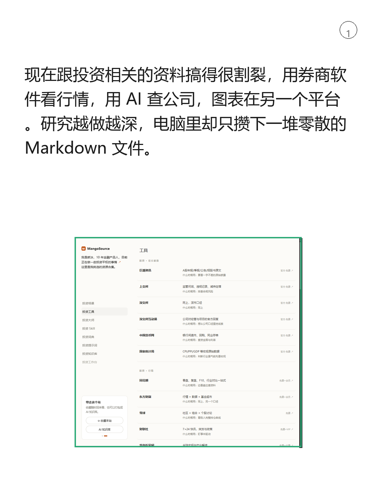

可每天准备研究时，眼前还是一堆工具名。自己为什么收集这个、上次用它解决了什么，要翻回笔记才想得起来。

我就想把这些入口彻底打通：点开一个场景，顺手就能看到该用什么工具、该问 AI 什么。

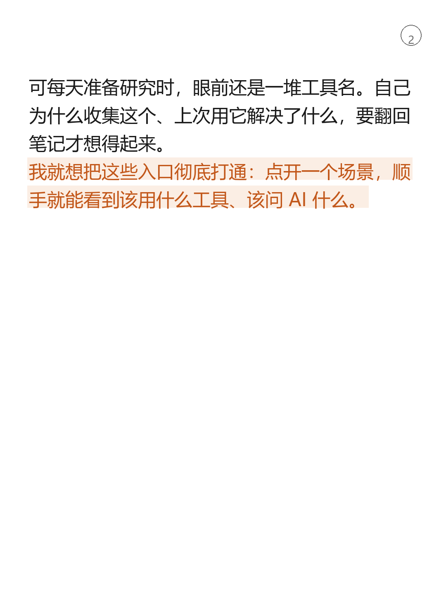

正好这个站能按「你遇到什么」组织。于是我把 21 个真实场景、44 个工具、21 位大师、9 类词典和 6 条提示词全接了进来，完全按我自己的使用习惯排了版。

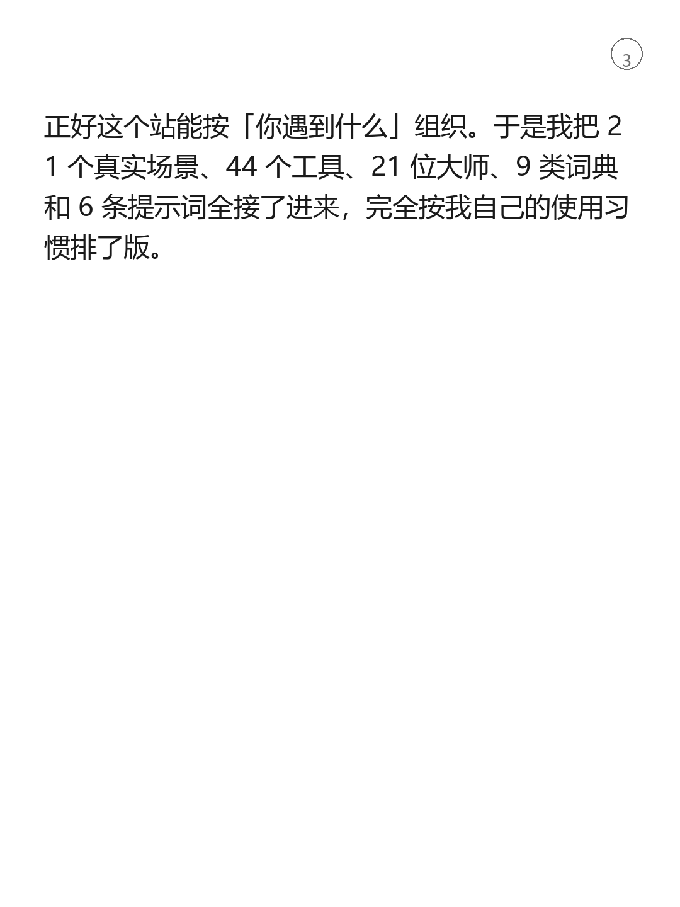

整个站主要分六块：投资场景、投资工具、投资大师、投资 Skill、投资词典、投资提示词。

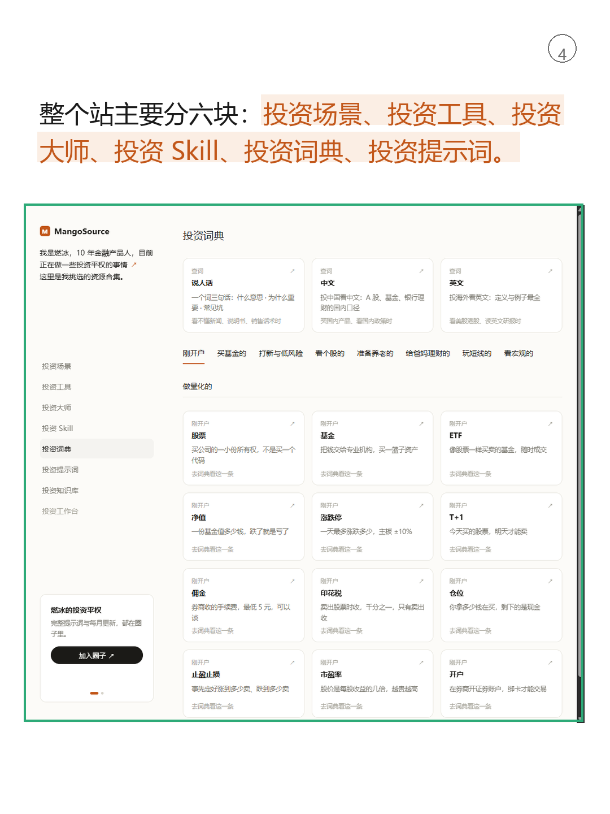

在「投资场景」这一页，每一条都是你真的会说出口的话。点开「基金跌了 8%，我想卖」，它给你三步解法，外加一段能直接复制给 AI 的提示词。

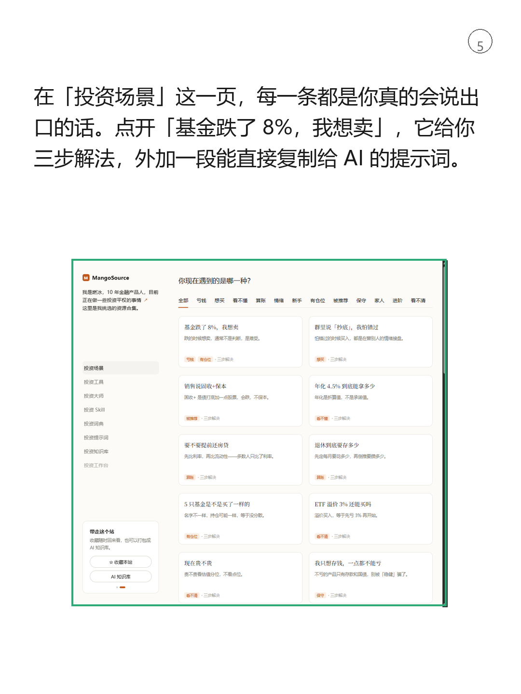

这些关注点现在有了日常查看的位置：选中一个场景，可以看它为什么卡住、分三步怎么走、今天先做哪一件事。碰到新消息，马上就能对照当时的判断依据，不用再去翻箱倒柜找笔记。

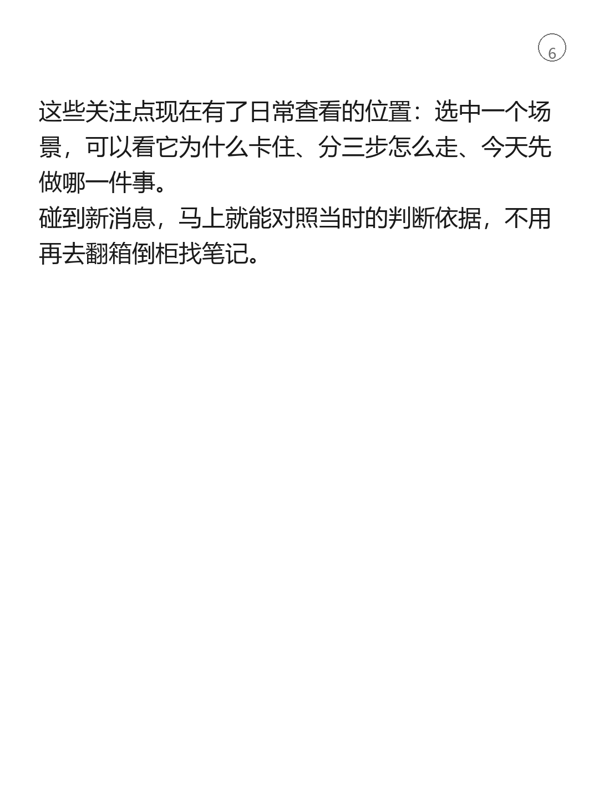

日常查工具、看词条，打开固定页面就够了。但我还想要一步：从你此刻的处境出发，直接把最该看的那层摆到面前。

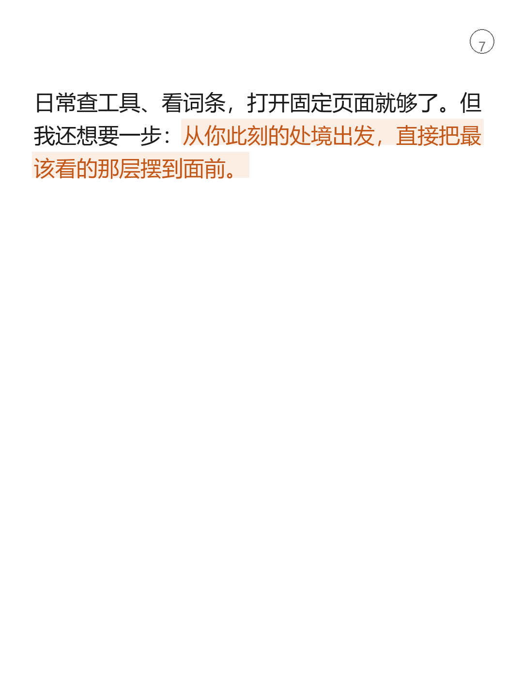

普通的资料站搭好后，每天只是机械地列一堆链接，至于今天该看什么、几组资料之间什么关系，还得自己去扒。这里的场景入口是按处境组织的：先看你「亏钱 / 想买 / 看不懂 / 算账」，再围绕这个处境把工具、词典、提示词摆齐。

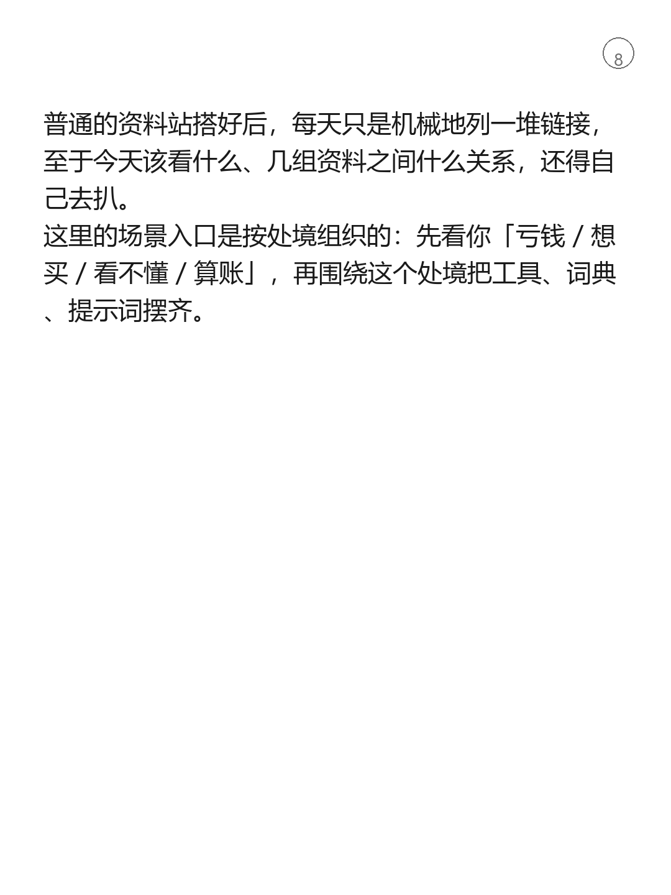

比如你点开「基金跌了 8%」，页面直接把承受线、同类回撤、下一个动作三件事摆在一起，不用在十几个页面里来回横跳、自己拼凑信息。

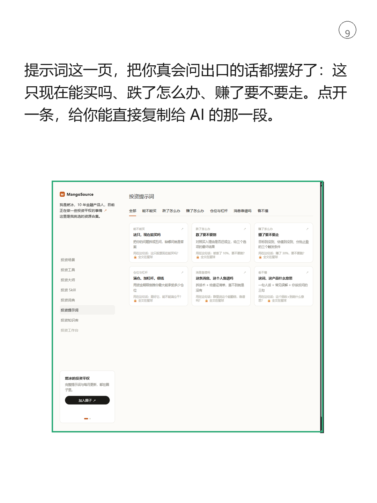

想看方法，就看投资大师和价值 / 成长 / 周期 / 量化 / 中国实践五派；想搞懂一个词，就按「你是谁」进对应的身份词典。

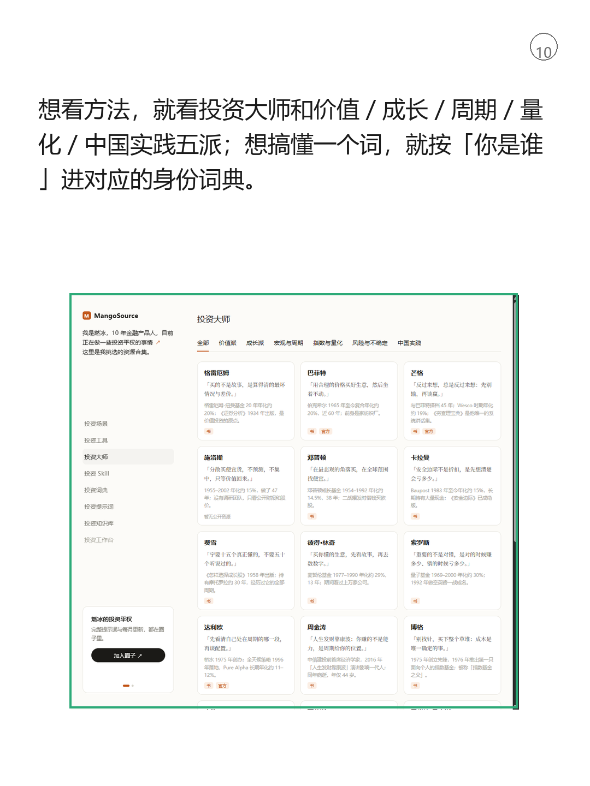

其实我之前试过自己从零写个资料站，但很快发现，前端只是皮毛，最要命的是背后的苦力活：资料从哪找？怎么核？不同来源的口径怎么对齐？多久更新一次？

所以我把它做成一个能持续用的站：数据和工具我核好，你只管把问题问对。

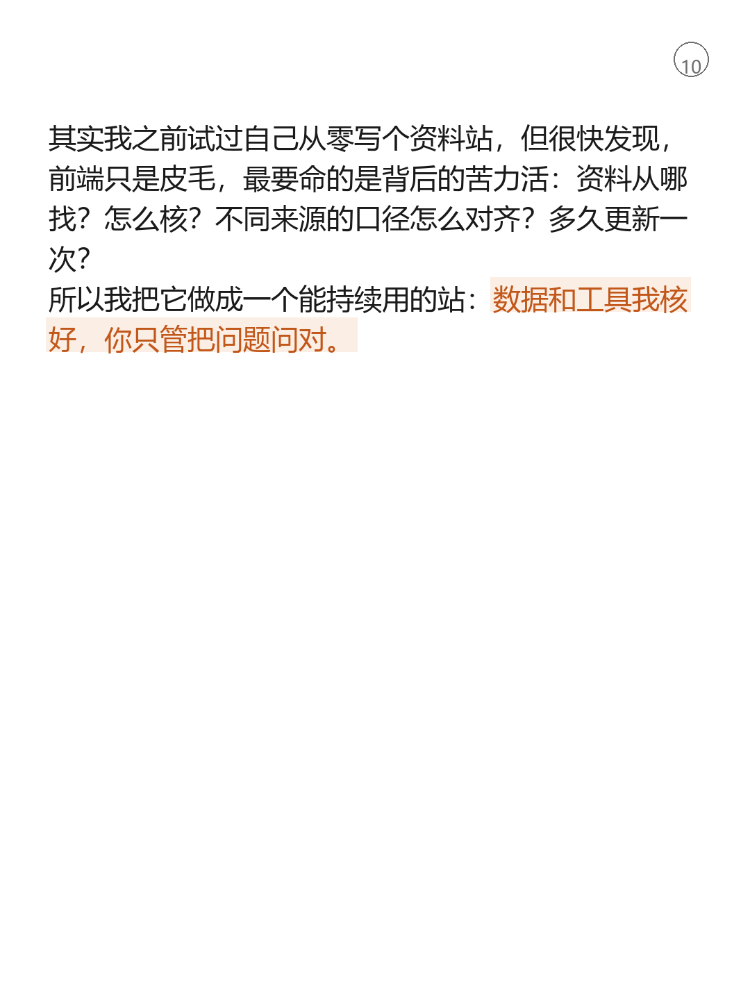

不荐股，不预测，不承诺收益。它只做一件事：帮你把问题问对，把最坏情况算清。

如果你也在各处攒了不少资料，可以试着把它们组织起来，让之前的工作在下一次打开时接着用。

地址在下面，扫码直接打开：

https://mangosource.app.workbuddy.host/?sharecode=DYPP2BGOV7

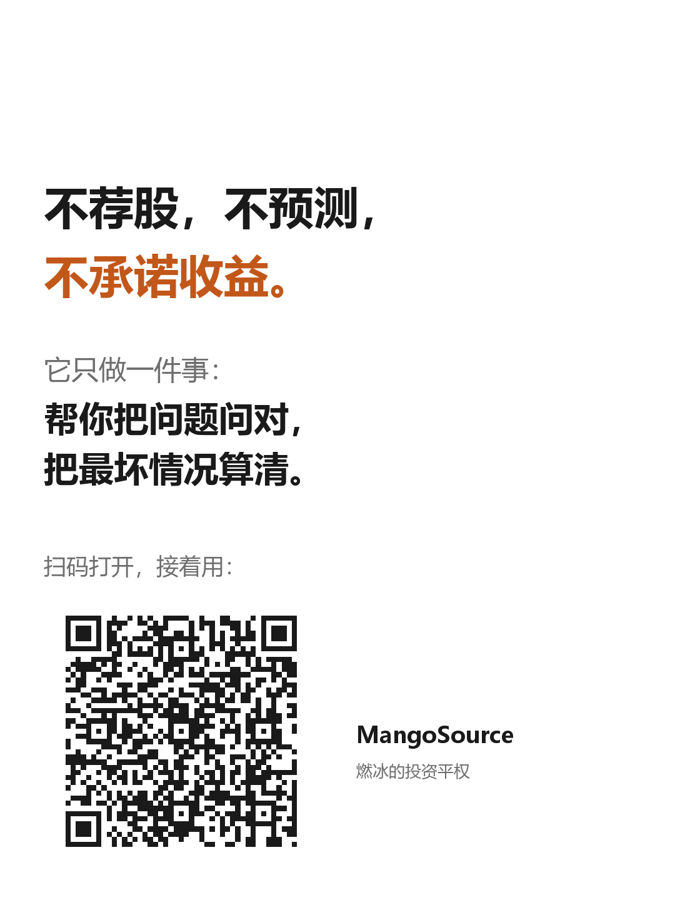

---

*边界说明：本文为信息整理与方法框架，不构成投资建议，不推荐标的，不预测涨跌，不承诺收益。*
